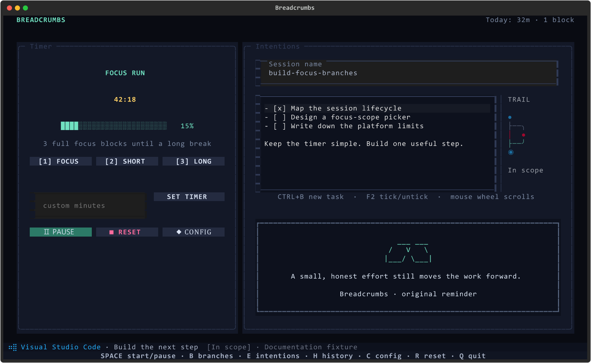
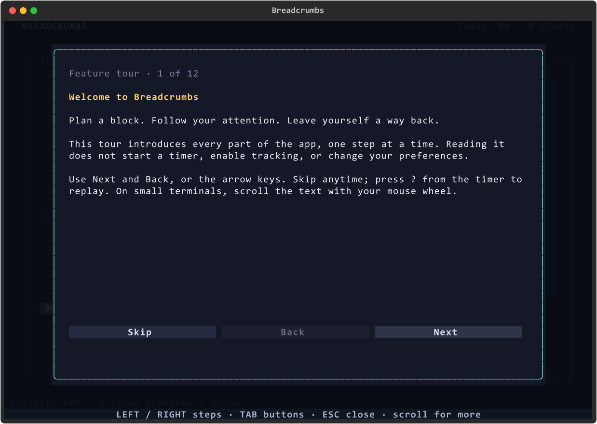
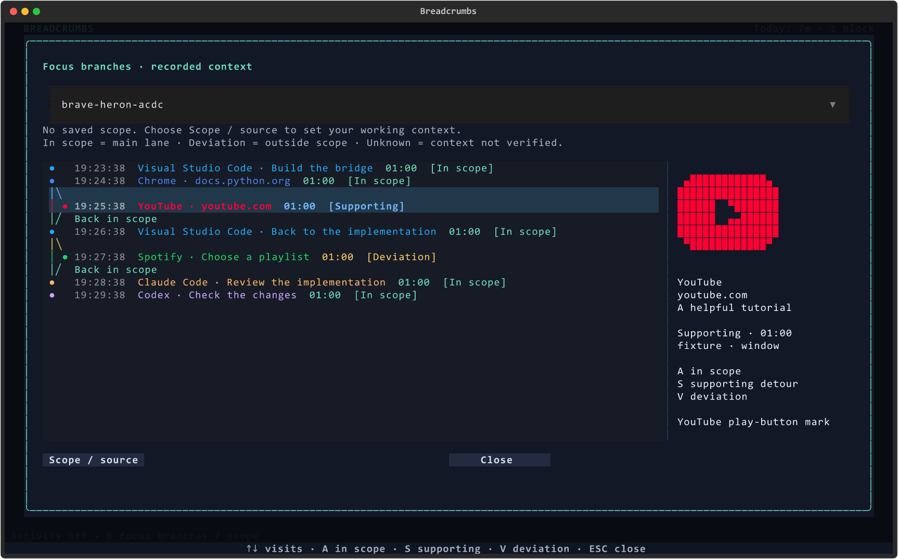

# Breadcrumbs

**Start with an intention. Leave yourself a trail back.**

A terminal focus companion for developers. Plan a block, work through a
checklist, and see where your attention went. Review the result when you're
done. Sessions, intentions, reflections, and activity stay in a local SQLite
database.

Breadcrumbs was previously called **Tlock**. This release brings the timer,
focus branches, and browser controls together under one name.

[Install](#install) · [First-run tour](#learn-the-app-step-by-step) · [User guide](docs/USAGE.md) ·
[Browser extension](docs/BROWSER_EXTENSION.md) ·
[Changelog](CHANGELOG.md) · [Roadmap](#roadmap)



*Actual interface with isolated documentation fixtures.*

## Why build this?

An hour of development rarely happens in one window. You move between an
editor, a terminal, documentation, and a coding agent. Sometimes a detour
helps; sometimes you lose the thread.

Breadcrumbs keeps the plan and the resulting trail together. It isn't trying
to decide whether every visit was productive. It gives you something concrete
to review: what you meant to do, where you went, and what you actually finished.

## What can I use it for?

| I want to… | Use this | Start here |
| --- | --- | --- |
| Work on one small thing | Focus timer, intentions, and a checklist | `E`, then `Escape`, then `Space` |
| Use a different work/break rhythm | Presets or custom minutes | `P` or **Set timer** |
| Remember what I was doing | Named checkpoints and recovery | `Q` saves; reopen to recover |
| See where my attention went | Optional scope and focus branches | Choose scope at Start; `B` reviews visits |
| Keep documentation in scope | Exact browser pages or domain rules | Pair the extension, then select scope |
| Recognize active CLI agent work | Verified Claude Code/Codex terminal markers | Open the agent, then choose it in scope |
| Control a block from the browser | Extension countdown and timer buttons | Open the paired extension popup |
| Review a useful detour | Supporting annotations | Select a visit in `B`, then `S` |
| Record what I finished | Reflection, optional rating, history | Finish a block; review with `H` |
| Keep a copy of my records | JSON export, with activity only on request | `breadcrumbs export --output sessions.json` |
| Adjust the look and feel | Themes, sound previews, companion, reading cards | `C` opens Config |

You can use the timer and checklist without tracking anything. Browser pairing,
activity capture, the companion, and reading cards are independently configurable.

## Install

Requires **Python 3.11+**. On Windows, run once in PowerShell:

```powershell
irm https://raw.githubusercontent.com/SaroashDS/Breadcrumbs/main/bootstrap.ps1 | iex
```

Then type:

```powershell
breadcrumbs
```

The installer creates a private runtime in `%LOCALAPPDATA%\Breadcrumbs`.
To install from a checkout:

```powershell
powershell -NoProfile -ExecutionPolicy Bypass -File .\install.ps1
```

On Linux or macOS:

```bash
git clone https://github.com/SaroashDS/Breadcrumbs.git
cd Breadcrumbs
python3 -m venv .venv
source .venv/bin/activate
python -m pip install .
breadcrumbs
```

The timer works on all three platforms. Native app capture supports Windows
and Linux/X11. macOS and Wayland native foreground capture are not implemented.
See [tracking support and limits](docs/ACTIVITY.md).

## Your first block

1. Press `E` to write intentions. `Ctrl+B` adds a task; `F2` checks it off.
2. Keep the generated name or enter your own. Choose a duration and press Space.
3. Select a focus scope, reuse your previous scope, or continue without tracking.
4. Work. The small trail shows context changes; `B` opens the detailed trail.
5. Finish the block and record what you accomplished.

For a quick try, enter **2** in custom minutes, choose **Set timer**, and write
one task such as “Read the failing test.” Choose **Continue without tracking**
on your first run if you just want to learn the timer. You can add scope later.

`C` opens Config, `H` opens history, and the bottom command bar stays visible.
Changing an active timer asks whether to keep working, finish early, or end it.

Only a full Focus countdown advances long-break progress. Custom timers and
early finishes still contribute to work totals. Completing a full long break
starts a fresh round.

## Learn the app step by step

The first launch of v0.4.0 opens a **12-page feature tour**. It also introduces
the new features to existing users who have not seen the tour. Use **Next**,
**Back**, or the left/right arrows. Text scrolls on smaller terminals.
**Skip** or `Escape` closes it; your choice is remembered.

Press **`?` from the ready or paused timer** to replay it. Saved-session recovery
comes first, and a running timer asks you to pause before opening the tour.
Reading the tour never starts a timer or enables capture.



*Actual first-launch screen, captured with an isolated temporary profile.*

Follow the [hands-on onboarding guide](docs/ONBOARDING.md) to try every feature
with small exercises. Suggested order:

1. Write a task and complete an untracked block.
2. Try pause, recovery, early finish, reflections, and history.
3. Choose app scope and inspect your trail.
4. Pair the browser, select a page, and try remote controls.
5. Add agent scope, personalize the app, and export your records.

## Timers, intentions, and recovery

**Choose a rhythm.** `1`, `2`, and `3` select Focus, Short break, and Long break.
`P` offers 25/5, 50/10, and 60/10 presets. Enter custom minutes and choose
**Set timer** for a standalone countdown. In `C`, set durations, the number
of full Focus blocks before a long break, and optional automatic starts.
With automatic starts off, the next timer waits for `Space`.

**Keep a checklist.** `E` focuses the multiline editor. `Ctrl+B` adds a task,
`Enter` continues it, and `F2` ticks or unticks the current task. Drafts save
before the timer starts. Unchecked tasks and notes carry to the next block;
completed tasks remain in the original block's history. Press `Escape` to
return to timer shortcuts so letter keys stop typing into the editor.

**Leave safely.** `Space` pauses; `Q` saves and quits. On reopening, choose a
saved block or start a new one. Recovery opens paused with its scope retained.
Time while the app is closed stays outside the block. Checkpoints are saved
about every second, so an abrupt shutdown can lose roughly the last second.

**Change your mind.** `F`, Reset, and changes to an active timer offer
**Keep working**, **Finish early**, or **End session**. Finish early records
elapsed work as completed and offers a reflection; End session retains
partial work without marking the block completed.

```powershell
breadcrumbs --name build-session-recovery
breadcrumbs sessions
breadcrumbs --resume calm-otter-a3f2
breadcrumbs export --output sessions.json
breadcrumbs export --activity --output activity.json
breadcrumbs update --check
breadcrumbs update
```

Session names must be unique and use letters, numbers, or hyphens; spaces are
converted to hyphens. `--session NAME` is another spelling of `--resume NAME`.

## Choose what counts as in scope

On Start, choose **Choose scope and start**, **Use previous scope**, or
**Continue without tracking**. Cancel leaves the new block unstarted.

| Scope target | Example | What matches |
| --- | --- | --- |
| App | Your editor | Foreground activity in that app |
| Domain | `docs.python.org` | That domain and its subdomains |
| Exact browser page | A selected documentation tab | The same URL identity, including query parameters |
| Terminal agent | A detected Codex CLI process | Verified process plus its active terminal marker |

Use `Space` to select targets in the picker and `Ctrl+S` to save. You can add
app names manually. Plaintext window/tab titles can be switched off. During a
block, **B → Scope / source** edits the scope; past running spans retain the
scope they used. Turning capture off keeps the timer available.

To try it, select your editor, start, switch to another app, and return.
The trail should show a departure and a return. Page and agent verification
need their respective integrations; missing evidence is shown as Unknown.

## Browser connection

Open **Config (C) → Browser connection**. The setup screen shows the bundled
extension folder, loopback address, and pairing token.

Load the folder as an unpacked extension in Chrome or Edge and pair it once.
No ActivityWatch service or account is required. The extension talks directly
to Breadcrumbs on this computer.

**Timer controls** and **browser sharing** are separate. Stopping sharing stops
tab reports; pausing the timer stops the block. Finish early requires
confirmation and saves elapsed work before opening the reflection in the TUI.

The extension picks up a session that was already started in the terminal.
Opening or reopening the popup reads timer status independently of tab capture.

[Extension setup and controls](docs/BROWSER_EXTENSION.md)

**A first browser exercise:** open a documentation page, pair the extension,
then select that page in scope. Switch to a different URL and return. The
same page rejoins scope, while a different query remains a different page.
Try Pause and Resume in the popup. Try Finish, cancel it once, then confirm
when you are ready to record the result in the terminal.

## Read the trail



*Documentation fixtures; the app displays recorded activity only.*

- **In scope:** matches your selected apps, URLs, domains, or verified agent.
- **Deviation:** outside the selected scope. It does not automatically mean
  wasted time; mark a useful detour Supporting.
- **Unknown:** the context could not be verified. A browser window title alone
  cannot establish whether an exact URL is in scope.
- **Away / Excluded:** idle or excluded context, kept separate from scope judgments.

Returning to a matching context joins the main lane. Use `A` for In scope,
`S` for Supporting, and `V` for Deviation.

Exact URL rules include query parameters. Similar titles don't make different
URLs equivalent. Selecting a browser app does not bypass page/domain rules.

Terminal agent selection verifies the process and a temporary marker in its
foreground terminal title. A running background agent alone is not evidence
of focus. Pinned tab titles, multiplexers, and unsupported terminal hosts can
prevent verification; the UI reports Unknown instead of guessing.

The block selector lets you inspect previous trails. Visit details show the
capture source and precision; explanations use the scope saved for that visit's
running span. Unknown, Away, and Excluded observations keep their labels.

## Reflect, review, and export

After a work block, write what you actually accomplished. Add a focus rating
from 1–5 if useful. `Ctrl+S` saves the reflection; `Escape` skips it. `H` shows
session intentions, reflections, elapsed time, and completion status.

The header shows today's work minutes and completed work blocks using your
computer's local date. Breaks are excluded. The long-break counter is separate:
it advances only after full Focus countdowns.

```powershell
# Session history, intentions, reflections, ratings, and timestamps
breadcrumbs export --output sessions.json

# Add observed activity, annotations, scope, and running spans
breadcrumbs export --activity --output activity.json

# Limit the export to the newest 20 sessions
breadcrumbs export --limit 20 --output recent.json
```

## Make it your own

Open **Config (`C`)**. Use `Ctrl+S` to save, or `Escape` to discard changes.

| Setting | What you can do |
| --- | --- |
| Visual theme | Choose Midnight Arcade, Game Boy, or Sunset Drive; the browser popup follows it |
| Completion melody | Enable/disable sounds and select Arcade, Victory, or Gentle |
| Sound preview | Hear the selected pack before saving, even with completion sounds disabled |
| Companion | Enable the optional pixel companion; `M` pets it and `N` changes it |
| Reading cards | Choose Off, Qur'an, or original reminder quotes |
| Card timing | Show cards in every block or only breaks, and rotate every 1–60 minutes |
| Book animation | Toggle the brief animation independently of card content |
| Automatic starts | Start the next break/focus automatically, or wait for `Space` |

Windows plays synthesized melodies; other platforms use the terminal bell,
which depends on terminal settings. Reading content is bundled locally.
Qur'an cards include Arabic, English meaning, and a reference; partial verses
are labeled as excerpts. See [reading sources](docs/READING.md).

## Keyboard quick reference

| Key | Action |
| --- | --- |
| `Space` | Start / pause / resume |
| `1` / `2` / `3` | Focus / short break / long break |
| `P` | Choose a preset rhythm |
| `E` | Edit intentions; `Escape` returns to timer controls |
| `Ctrl+B` / `F2` | Add task / check or uncheck task while editing |
| `B` | Focus branches, visit labels, and scope settings |
| `F` / `R` | Finish/end choices / reset |
| `H` / `C` | History / Config |
| `?` | Replay the feature tour while ready or paused |
| `M` / `N` | Pet / change the optional companion |
| `Q` | Save and quit |

## Your data

New installs use `~/.breadcrumbs/breadcrumbs.db` and
`~/.breadcrumbs/config.json`. Set `BREADCRUMBS_HOME` to choose another directory.

Existing Tlock data in `~/.tlock` is reused in place, including `tlock.db`.
The rename does not move or delete your history. Legacy `TLOCK_HOME` and
`TLOCK_REPOSITORY` overrides remain supported; the new names take precedence.

Capture is opt-in and runs during running focus/custom blocks. Pause, breaks,
and quitting stop it. Unselected tab inventories are temporary; exports include
activity only when you request `--activity`.

The extension sends domains and hashed URL identities, never raw URL paths or
queries. Plaintext titles are optional. Unverified browser window titles are
discarded. Hashes identify pages; they are not a guarantee of anonymity.

## Upgrading from Tlock

Close the old app, then run the installer above. Existing `tlock` commands
forward to Breadcrumbs; use `breadcrumbs` for new commands and scripts.
Existing sessions and recovery names remain valid.

The browser extension folder changed with the package rename. Remove the old
unpacked extension, run `breadcrumbs browser path`, load that folder, and pair
it from **Config → Browser connection**. Later updates to that folder normally
need only the extension's Reload button.

## Roadmap

Breadcrumbs is the first tool in a planned suite of small terminal productivity
apps for developers. Each tool should work on its own, share documented local
data, and make it easier to return to the work.

Next directions: weekly review, editor/project context, better terminal-pane
integration, and broader desktop support.

## Development

```powershell
python -m pip install -e ".[dev]"
python -m pytest -q
node --test breadcrumbs/assets/browser-extension/tests/worker.test.mjs breadcrumbs/assets/browser-extension/tests/ui.test.mjs
```

[QA and real-browser checks](docs/TESTING.md) ·
[Brand artwork credits](docs/BRANDS.md) ·
[Architecture and research](docs/FOCUS_BRANCHES.md)

MIT licensed. Brand marks belong to their respective owners.
